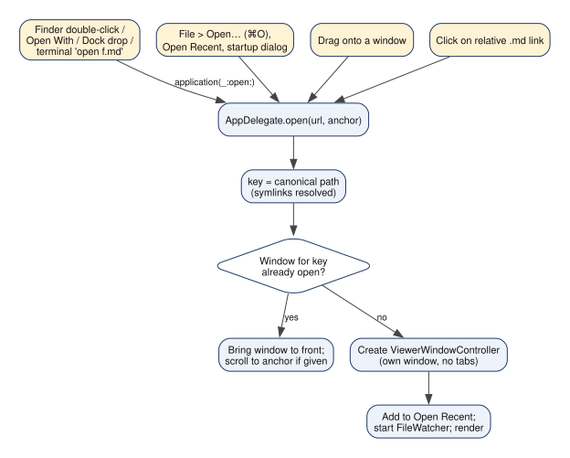
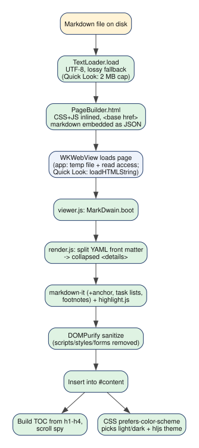
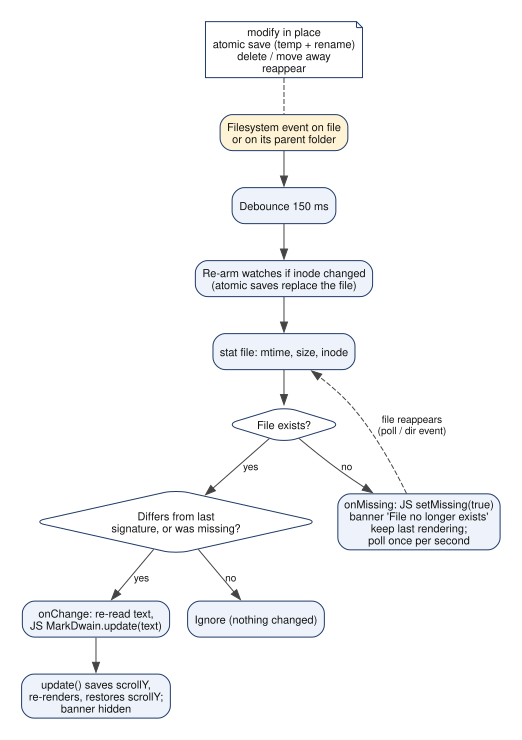
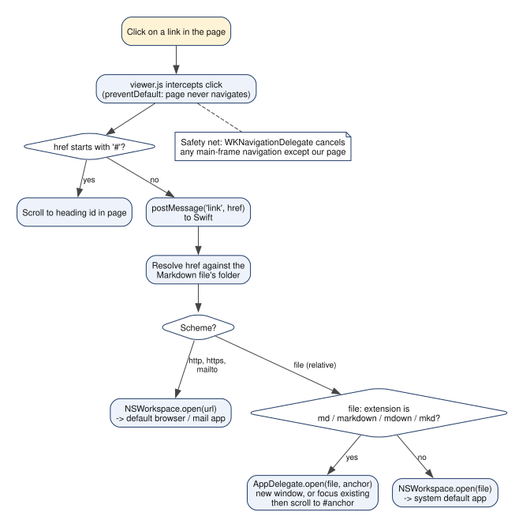
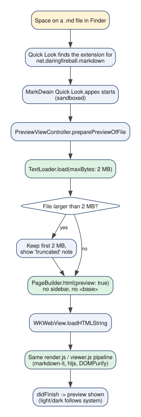
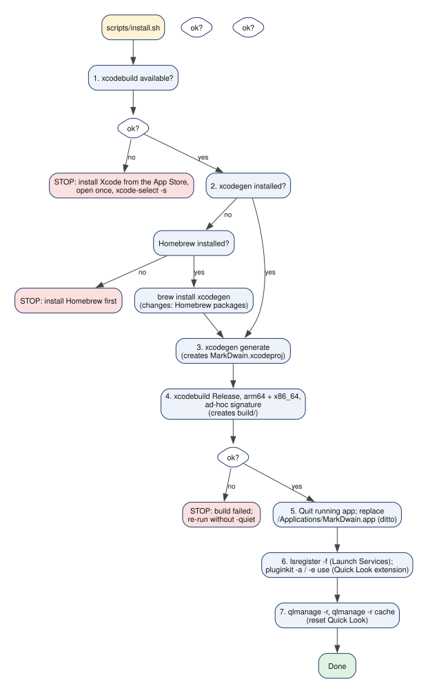

# MarkDwain Architecture

## 1. Overview

MarkDwain is a small, read-only Markdown viewer for macOS 14+. It has **two build targets** defined in `project.yml`:

| Target | What it is | Bundle ID |
|---|---|---|
| **MarkDwain** | The viewer app: one window per Markdown file, live reload, table of contents, zoom, find. Not sandboxed. | `local.markdwain` |
| **MarkDwain Quick Look** | A sandboxed Quick Look *preview extension* (Space in Finder). Embedded inside the app bundle. | `local.markdwain.quicklook` |

Both targets compile the same folders: `Shared/Swift` (page builder, text loader) and `Shared/Web` (HTML/CSS/JS renderer plus vendored libraries). Rendering happens **inside a WKWebView in JavaScript**, so the app and Quick Look use exactly the same pipeline.

## 2. Component diagram

```
 Finder / Dock / terminal / ⌘O ──► AppDelegate ──► ViewerWindowController (one per file)
                                     │  menus (MainMenu)          │  ├─ FileWatcher  (live reload)
                                     │  Prefs (zoom, sidebar)     │  ├─ WKWebView ◄──► viewer.js (message "mdw")
                                     ▼                            │  └─ link routing ──► AppDelegate.open / NSWorkspace
                              ┌─────────────────────────── shared ───────────────────────────┐
                              │ TextLoader (read file)  PageBuilder (HTML page)               │
                              │ Web/: render.js ► markdown-it, highlight.js, DOMPurify        │
                              │       viewer.js, viewer.css                                   │
                              └──────────────────────────────────────────────────────────────┘
 Finder Space ──► PreviewViewController (Quick Look extension) ──► same shared code
```

## 3. Dependencies

There are **no runtime network dependencies**: every library is a file in `Shared/Web/vendor/`, inlined into the page. No Swift packages are used.

| Name | Version | Purpose | License | Location | How to update |
|---|---|---|---|---|---|
| markdown-it | 15.0.3 | Markdown to HTML | MIT | `Shared/Web/vendor/markdown-it.min.js` | See DEVELOPMENT.md, "Updating bundled libraries" |
| markdown-it-anchor | 10.0.0 | Heading ids (GitHub-style slugs) | Unlicense | `vendor/markdownItAnchor.umd.js` | same |
| markdown-it-task-lists | 2.1.0 | Read-only checkboxes | ISC | `vendor/markdown-it-task-lists.min.js` | same |
| markdown-it-footnote | 4.0.0 | Footnotes | MIT | `vendor/markdown-it-footnote.min.js` | same |
| highlight.js | 11.12.0 | Syntax highlighting (common-languages build, 36 languages) | BSD-3-Clause | `vendor/highlight.min.js`, themes `hljs-github*.min.css` | same |
| DOMPurify | 3.4.17 | HTML sanitizer | Apache-2.0 / MPL-2.0 | `vendor/purify.min.js` | same |
| XcodeGen | any recent (dev tool) | Generates the Xcode project from `project.yml` | MIT | installed by Homebrew, not in repo | `brew upgrade xcodegen` |
| Graphviz | any recent (dev tool) | Draws the diagrams in `docs/diagrams` | EPL | Homebrew, only needed to regenerate diagrams | `brew upgrade graphviz` |

## 4. Repository map

| Path | What it is |
|---|---|
| `project.yml` | XcodeGen spec: targets, Info.plist contents, document types, signing. The app name lives here. |
| `App/Sources/` | Swift sources of the app (see section 5). |
| `App/Assets.xcassets/AppIcon.appiconset` | The app icon (copied unchanged from `Assets/`). |
| `App/Help.md` | Shown by Help > MarkDwain Help; bundled into the app. |
| `QuickLook/PreviewViewController.swift` | Quick Look extension code. |
| `QuickLook/MarkDwainQuickLook.entitlements` | Sandbox entitlements of the extension. |
| `Shared/Swift/PageBuilder.swift`, `TextLoader.swift` | Swift used by both targets. |
| `Shared/Web/render.js`, `viewer.js`, `viewer.css` | Rendering pipeline, page behaviour, styling. |
| `Shared/Web/vendor/` | Third-party JS/CSS (section 3). |
| `Samples/` | `feature-tour.md` exercises every feature; `other.md` is its link target; `images/` holds the sample image. |
| `scripts/install.sh`, `uninstall.sh`, `make-diagrams.sh` | Install, uninstall, diagram regeneration. |
| `tests/render-test.js` | Node test of the Markdown pipeline. |
| `tests/watcher/` | Compiled test for FileWatcher (in-place, atomic, delete, reappear). |
| `tests/snapshot/` | Tool that renders a file offscreen to a PNG for visual checks. |
| `docs/` | This documentation; `docs/diagrams/` holds each `.dot` source and its `.svg`. |
| `Assets/` | Original icon deliverables (SVG master, icns, PNG). |
| `build/`, `MarkDwain.xcodeproj/` | Generated, git-ignored. |

## 5. Main components

**`main.swift`** starts `NSApplication` with `AppDelegate`. Plain AppKit was chosen over a SwiftUI `App` because menus, one-window-per-file and open-URL events are simplest to control directly.

**`AppDelegate.swift`**: lifecycle, registry of windows, all menu actions.
- `open(_:anchor:)`: the single entry point for opening a file; dedupes by canonical path (flow 1).
- `application(_:open:)`: Finder, Dock, terminal. `showOpenPanel`: startup dialog and ⌘O.
- `menuNeedsUpdate`: builds Open Recent by hand. Zoom, sidebar, Reveal in Finder, Open With… actions.
- Talks to: `ViewerWindowController`, `Prefs`, `NSWorkspace`, `NSDocumentController` (recent list only).

**`MainMenu.swift`**: builds the menu bar in code. Find items use `performTextFinderAction:` which WKWebView implements itself (⌘F/⌘G/⇧⌘G).

**`ViewerWindowController.swift`**: one window per file.
- `loadPage`: reads the file, builds the page with `PageBuilder`, writes it to `$TMPDIR/MarkDwain/<uuid>.html` and loads it with `loadFileURL(allowingReadAccessTo: "/")`.
- `fileChanged` / `fileMissing`: called by `FileWatcher`; run JS `MarkDwain.update/setMissing`.
- `route(href:)` and `decidePolicyFor`: link handling (flow 4). `prefsChanged`: applies `pageZoom` and sidebar state.
- `DropWebView`: accepts files dropped on the window. Talks to: WKWebView, FileWatcher, PageBuilder, TextLoader, AppDelegate.

**`FileWatcher.swift`**: watches the file *and* its parent folder with `DispatchSource`, debounces 150 ms, re-arms on inode change, polls once a second only while the file is missing (flow 3).

**`Prefs.swift`**: UserDefaults wrapper (zoom 50-300 %, sidebar visibility, window size) that posts `Prefs.changed`.

**`PageBuilder.swift`** (shared): returns the full HTML string. Inlines CSS and all JS (so it works in the sandboxed extension), adds `<base href>` (app only) so relative images resolve, and embeds the Markdown plus options as JSON in a `MarkDwain.boot(...)` call.

**`TextLoader.swift`** (shared): reads UTF-8 with lossy fallback and an optional byte cap.

**`render.js`**: front matter, markdown-it with plugins, highlight.js, DOMPurify. **`viewer.js`**: `boot`, `update` (keeps scroll), TOC and scroll spy, link click interception, banners, hover bar. **`viewer.css`**: styling and dark mode.

**`PreviewViewController.swift`** (Quick Look): reads max 2 MB, builds the page with `preview: true`, loads it with `loadHTMLString`, finishes when the page has loaded.

## 6. Main flows

### 6.1 Opening a file and window management



1. A file arrives from Finder/Dock/terminal (`application(_:open:)`), from the Open dialog or Open Recent, from a drop, or from a link click.
2. All paths call `AppDelegate.open(url, anchor)`.
3. The URL is canonicalised (symlinks resolved) into a key.
4. If a window with that key exists, it is brought to front (and scrolled to the anchor).
5. Otherwise a `ViewerWindowController` is created, cascaded from the frontmost viewer, added to Open Recent and starts watching the file. Closing it removes the key; closing the last window quits.

### 6.2 Rendering pipeline



1. `TextLoader` reads the file (lossy UTF-8). **Shared with Quick Look**, as are all other steps down to the theme; only the way the page is loaded into the web view differs.
2. `PageBuilder` assembles one HTML string with CSS, JS and the Markdown embedded as JSON. **Shared.**
3. The web view loads it (app: temp file with read access; Quick Look: `loadHTMLString`).
4. `MarkDwain.boot` calls `render()`: YAML front matter is split off and shown as a collapsed block, markdown-it converts the rest, highlight.js colours code, DOMPurify removes scripts/styles/forms.
5. The HTML goes into `#content`; the TOC is built from `h1`-`h4`.
6. CSS `prefers-color-scheme` picks the light or dark palette and highlight theme.

### 6.3 Live reload



1. Events arrive from the file watch (in-place writes) and the folder watch (renames, creates, deletes).
2. They are debounced 150 ms.
3. The watcher re-arms if the file's inode changed (an atomic save replaced it).
4. It compares the file's signature (mtime, size, inode) with the last one.
5. Missing: the page shows the banner and keeps the old content; polling starts. Reappeared or changed: the text is re-read and `MarkDwain.update` re-renders, restoring `scrollY`, and hides the banner.

### 6.4 Link handling



1. `viewer.js` intercepts every click on a link so the web view never navigates.
2. `#anchor` scrolls inside the page (the `<base>` tag would otherwise turn it into a navigation).
3. Anything else is sent to Swift, which resolves it against the Markdown file's folder.
4. `http`, `https`, `mailto` go to the default app. Local Markdown files open via `AppDelegate.open` (new or existing window, with anchor). Other local files open with `NSWorkspace`.
5. As a safety net, the navigation delegate cancels any main-frame navigation except the page itself.

### 6.5 Quick Look preview



1. Space in Finder; macOS picks the extension registered for `net.daringfireball.markdown`.
2. The sandboxed extension starts and `preparePreviewOfFile` is called.
3. `TextLoader` reads at most 2 MB; if the file is larger, a "truncated" note is shown.
4. `PageBuilder` builds the page without sidebar or `<base>`, the web view loads it and runs the same renderer.
5. The preview is returned to Quick Look once loading finishes.

### 6.6 Install script



1. Checks for Xcode (stops with instructions if missing).
2. Checks for XcodeGen; installs it with Homebrew, or stops if Homebrew is absent.
3. Generates the Xcode project.
4. Builds Release for arm64 and x86_64 with an ad-hoc signature into `build/`.
5. Quits any running copy and replaces `/Applications/MarkDwain.app`.
6. Registers the app with Launch Services and enables the extension with `pluginkit`.
7. Resets Quick Look caches.

## 7. Key decisions and trade-offs

- **Native shell + WebView renderer.** A real Mac app gives Finder integration, windows, menus and Quick Look; rendering Markdown in JS gives GitHub-like output with mature libraries and lets the app and Quick Look share one pipeline.
- **Not sandboxed (app).** Documents reference images and files anywhere on disk; a sandbox would need a permission prompt for each folder. The Quick Look extension *must* be sandboxed and is.
- **Page generated and loaded from a temp file.** `loadFileURL(allowingReadAccessTo: "/")` is the robust way to let `file://` pages load local images. The `<base href>` points at the document's folder.
- **`pageZoom` for zoom.** It scales layout like Safari's zoom and keeps find and scrolling correct, unlike CSS zoom.
- **Watching the parent folder as well as the file** because atomic saves replace the file's inode.
- **Everything inlined into the page**, because the sandboxed extension can't freely read resource files and one code path is simpler.
- **Signing.** The project uses an ad-hoc signature ("Sign to Run Locally") with no Apple account. This worked here for the app and for registering the Quick Look extension with `pluginkit` (see README for what was verified).
- **Hand-built Open Recent and menus.** `NSDocumentController`'s automatic menu expects `NSDocument` subclasses, which this app does not use.
- **`SANITIZE_DOM` disabled in DOMPurify** so headings whose slug matches a DOM property name (e.g. "Name") keep their id; the code never reads DOM properties by name.

## 8. Known limitations and deliberate omissions

- Quick Look cannot show relative images (sandbox); the sandbox is deliberately not weakened. No sidebar, links or live reload there.
- Quick Look preview is capped at 2 MB. Another app that claims Markdown previews may win; see DEVELOPMENT.md.
- The TOC sidebar scales with zoom (it is part of the page).
- Not built on purpose: editing, tabs, export/print, math, Mermaid, sync, App Store distribution.
- Footnotes and `<details>` work; other GitHub-only extensions (alerts, emoji shortcodes) are not rendered.
